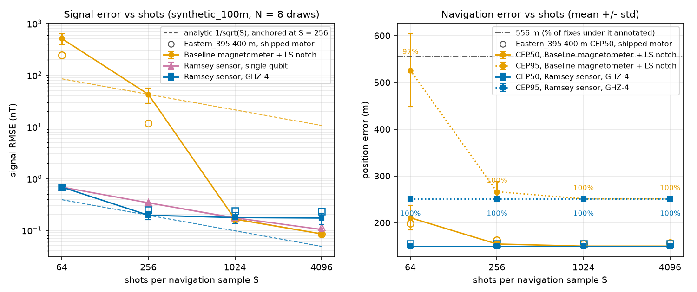
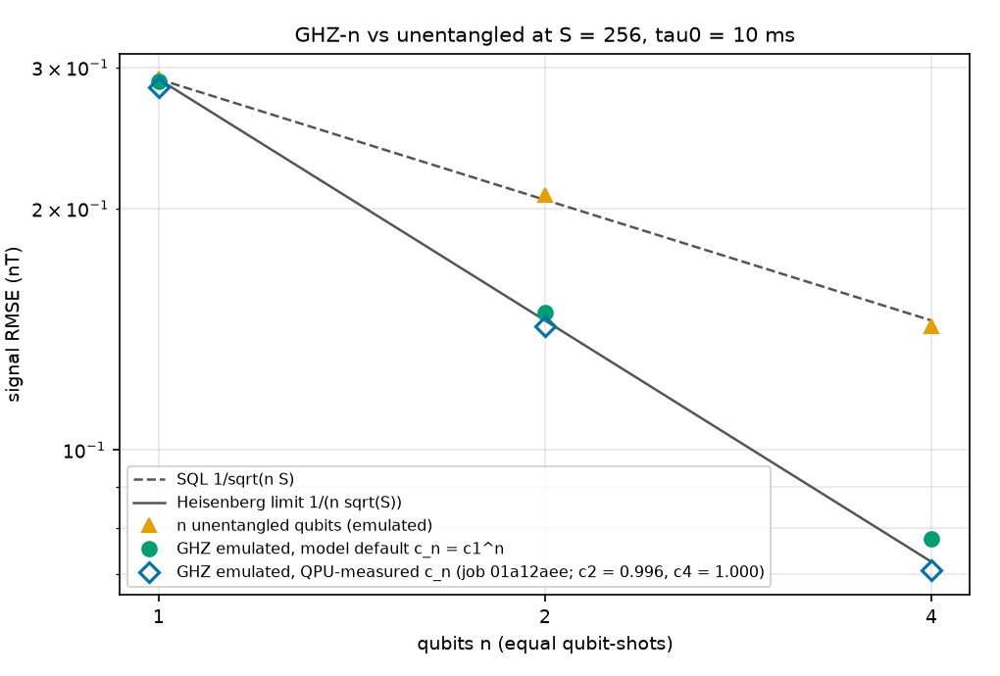
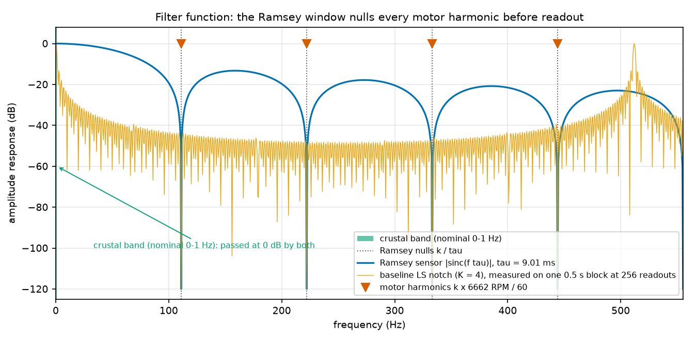

# Quantum MagNav: UAV Navigation using an Emulated Quantum Magnetometer in a GPS-jammed region

Quantum MagNav keeps a UAV located after GPS is jammed by matching the magnetic field it measures against an anomaly map. "UAV" covers both fixed-wing aircraft and multirotor drones; the headline scenario is a drone at 100 m altitude, the second a UAV at 400 m over a real survey map of eastern Ontario. The motor drowns the field in tones, so the magnetometer is modelled as a quantum sensor (Ramsey interferometry, run as one circuit on IonQ through Qollab) that sets its measurement window from the motor RPM and cancels the tones before any data exists. We found that the quantum sensor, with its passive noise filtering, beats an ordinary magnetometer plus classical notch filter at the same number of measurements per sample: at 256 shots its signal error is about 200 times smaller (0.195 nT vs 42.7 nT RMSE) and its position error is lower (CEP50 150.2 m vs 154.8 m; 150.2 m vs 210.9 m at 64 shots). At high shot budgets the two tie ([Where it ties or loses](#where-it-ties-or-loses)). Built for the Qollab x IonQ Hackathon (theme: Quantum Impact).


## In plain terms

- **Ramsey magnetometer (single qubit).** A qubit is put in superposition, left to accumulate a phase proportional to the magnetic field for an interrogation time τ, then measured. Repeating this S times (S = **shots** per navigation sample) gives the field; the random spread of the outcomes is the **projection noise**.
- **GHZ entangled probe.** n qubits are entangled into one GHZ state, which picks up n times the phase of a single qubit. Its projection noise falls as 1/n (the Heisenberg limit) instead of 1/√n for n unentangled qubits (the standard quantum limit). That is entanglement-enhanced sensitivity: it beats what the same number of unentangled qubits can reach, but only until gate error and decoherence erode it (Huelga 1997, Monz 2011; see [What is quantum here](#what-is-quantum-here)).
- **Notch filter.** A filter that removes a narrow frequency band. The classical baseline needs one tuned to the motor's RPM harmonics; the quantum sensor gets the same effect by choosing its interrogation time.
- **TERCOM.** Classical map matching: compare a strip of measured field values with the map and pick the best-fitting position.
- **Inertial navigation sensor only (INS).** Position from the aircraft's own motion sensors, with no map matching; its error grows with time.
- **CEP50 / CEP95.** The radius that contains 50 % / 95 % of the position errors after GPS loss. Smaller is better.
- **Under 556 m.** Share of time the error stays below 556 m (0.3 nautical miles, the RNP 0.3 navigation tolerance).
- **Signal RMSE (nT).** Root-mean-square error of the cleaned field reading against the true crustal field, in nanotesla.

## Run it on Qollab

1. On the project's **Code** tab press **Run Project**, choose the **IonQ Forte 1** remote simulator as the backend, then press **Run**.
2. Wait for Pyodide (Python in the browser) to load. Until then the preview frame reads "refused to connect" or shows the loading screen; that is expected.
3. The recorded replay loads first. To draw a new motor, keep "UAV (live, IonQ-drawn motor)" selected and press **Run one IonQ job**.
4. Watch the map, then open "This Run's IonQ job" and "Sensor" for the job ID, the quantum random seed, the measured GHZ contrast and the filter function.

Each Run sends exactly one circuit to IonQ; if the job fails or exceeds 90 s, the page falls back to the recorded replay with identical visuals. The built-in simulator works too. No IonQ hardware (QPU) is used during the demo. One job did run on IonQ Forte 1 hardware beforehand (job `01a12aee-d8a8-7e14-b9aa-b11329aca850`), because the simulators only give pseudo-random bits and returned an ideal GHZ contrast of 1.000: the hardware job supplied physically random bits for the shipped replay's motor seed (`c1dfff10e69fae05`) and measured the GHZ contrasts on a real trapped-ion device, so the shipped evidence carries a QPU-measured row. The live demo stays on the simulator because hardware runs spend credits.

## Results

All numbers come from `python -m magnav.regen` ([`results/`](results/metrics.json), all tables in [docs/BENCHMARK.md](docs/BENCHMARK.md)). The headline 100 m scenario uses a **synthetic map (sensitivity study), not survey data**: plausible synthetic data with the statistics of real crustal anomaly fields, generated at high spatial resolution so that navigation over the short distances of the 100 m scenario is meaningful. The 400 m scenario uses the real Eastern_395 survey map. Each row is the mean ± std over 8 seeded motor draws at S = 256 shots per navigation sample.

| Sensor (S = 256, N = 8) | CEP50 position error | CEP95 | Time under 556 m | Signal error (RMSE) |
|---|---|---|---|---|
| Baseline magnetometer + least-squares notch | 154.8 ± 5.1 m | 266.5 ± 21.0 m | 100 % | 42.7 ± 13.9 nT |
| Ramsey sensor, single qubit | 150.2 ± 0.0 m | 251.4 ± 0.0 m | 100 % | 0.339 ± 0.012 nT |
| Ramsey sensor, GHZ-4 fine stage | 150.2 ± 0.0 m | 251.4 ± 0.0 m | 100 % | 0.195 ± 0.035 nT |
| Inertial navigation sensor only (INS) | 974.5 m | 2035.9 m | 27.2 % | n/a |

The shots ladder shows where the gain comes from:

| Shots per sample S | Baseline CEP50 | GHZ-4 CEP50 | Baseline signal RMSE | GHZ-4 signal RMSE |
|---|---|---|---|---|
| 64 | 210.9 ± 26.3 m | 150.2 m | 512.5 nT | 0.684 nT |
| 256 | 154.8 ± 5.1 m | 150.2 m | 42.7 nT | 0.195 nT |
| 1024 | 150.2 m | 150.2 m | 0.164 nT | 0.176 nT |
| 4096 | 150.2 m | 150.2 m | 0.085 nT | 0.172 nT |



At low S the baseline samples too slowly: many motor harmonics alias next to DC, its notch must drop them (463 harmonic fits dropped per flight on average at S = 64), and the leftover tones degrade map matching. The Ramsey sensor nulls every harmonic inside its own window regardless of S.

Entangled probes add a second, genuinely quantum effect: entangled probes lower projection noise per shot by up to n at equal shot budget, until gate error and dephasing erode it. At S = 256 the GHZ-4 projection noise is 0.078 nT at the model contrast and 0.071 nT at the contrast measured on IonQ Forte 1 hardware, against 0.145 nT at the standard quantum limit for 4 unentangled qubits ([docs/PHYSICS.md](docs/PHYSICS.md#6-ghz-entangled-probes-the-two-stage-sensor)).



### Recorded flights after GPS loss

One recorded flight per map, seeded with the motor drawn on IonQ hardware (single flights, not the 8-draw mean).

Position error after GPS loss (from t = 285 s): UAV at 100 m over a synthetic crustal map, recorded flight

| Track | CEP50 (m) | CEP95 (m) | Under 556 m (%) | Signal RMSE (nT) | Windows accepted |
|---|---|---|---|---|---|
| Inertial navigation sensor only (INS) | 974.5 | 2,035.9 | 27.2 | n/a | n/a |
| Baseline: magnetometer + notch | 149.3 | 262.9 | 100.0 | 39.1 | 61 of 62 |
| Baseline variant: block mean | 149.3 | 262.9 | 100.0 | 42.8 | 61 of 62 |
| Quantum: single-qubit Ramsey | 150.2 | 251.4 | 100.0 | 0.3 | 62 of 62 |
| Quantum: GHZ-4 entangled | 150.2 | 251.4 | 100.0 | 0.2 | 62 of 62 |

#### Both scenarios, as found

Recorded flights with the stored motor draw, S = 256 shots, scored once under a rule fixed before the run. A live run does not change this table.

> At 100 m on the synthetic map the quantum navigation advantage shrinks compared with the 400 m Eastern_395 flight: GHZ-4 vs LS baseline CEP50 advantage -0.9 m at 100 m vs +27.5 m at 400 m; TERCOM matches lost (LS baseline / GHZ-4) 1/62 vs 0/62 at 100 m and 10/62 vs 0/62 at 400 m. The signal-level advantage (39.1 nT vs 0.2 nT at 100 m) does not depend on the map.

`verdict: shrinks`

Navigation and signal results for both maps, as found

| Measure | UAV at 100 m over a synthetic crustal map<br>synthetic map (sensitivity study), not survey data | UAV at 400 m over the Eastern_395 survey map<br>Eastern_395 survey map (SGL 2020, MagNav.jl) |
|---|---|---|
| **Inertial navigation sensor only (INS)** | | |
| CEP50 (m) | 974.5 | 974.5 |
| CEP95 (m) | 2035.9 | 2035.9 |
| Under 556 m (%) | 27.2 | 27.2 |
| **Baseline: magnetometer + notch** | | |
| Signal RMSE (nT) | 39.1 | 39.1 |
| CEP50 (m) | 149.3 | 182.2 |
| CEP95 (m) | 262.9 | 420.2 |
| Under 556 m (%) | 100 | 95.1 |
| TERCOM matches lost | 1 of 62 | 10 of 62 |
| **Baseline variant: block mean** | | |
| Signal RMSE (nT) | 42.8 | 42.8 |
| CEP50 (m) | 149.3 | 208.5 |
| CEP95 (m) | 262.9 | 442.3 |
| Under 556 m (%) | 100 | 100 |
| TERCOM matches lost | 1 of 62 | 17 of 62 |
| **Quantum: single-qubit Ramsey** | | |
| Signal RMSE (nT) | 0.3 | 0.3 |
| CEP50 (m) | 150.2 | 154.7 |
| CEP95 (m) | 251.4 | 420.2 |
| Under 556 m (%) | 100 | 95.1 |
| TERCOM matches lost | 0 of 62 | 0 of 62 |
| **Quantum: GHZ-4 entangled** | | |
| Signal RMSE (nT) | 0.2 | 0.2 |
| CEP50 (m) | 150.2 | 154.7 |
| CEP95 (m) | 251.4 | 420.2 |
| Under 556 m (%) | 100 | 95.1 |
| TERCOM matches lost | 0 of 62 | 0 of 62 |

Comparison rule: advantage = baseline_ls - quantum_ghz4 (CEP50 m, TERCOM matches lost); d = 100 m - 400 m; CEP50 tie band 10 m; grows / shrinks / stays about the same / is mixed.

### Where it ties or loses

- **High shot budgets tie; the baseline wins on signal error.** At S = 1024 and 4096 every estimator sits on the same 150.2 m CEP50 floor set by map matching. At S = 4096 the baseline's signal RMSE (0.085 nT) beats GHZ-4 (0.172 nT) and the single qubit (0.104 nT). GHZ-4 levels off near 0.17 nT from 1024 shots on (likely residual tone leak; mechanism not isolated).
- **GHZ-4 adds nothing at S = 64.** The frozen switch rule keeps the fine stage off there.
- **Without the RPM the quantum sensor fails.** If the RPM channel is withheld, the tone phase exceeds the sensor's ±π/2 range, the probe slips 1800 cycles per flight and CEP50 becomes 7676 m. The baseline falls back to a block mean and barely changes (155.3 m vs 154.8 m).
- **Between harmonics the classical filter rejects more.** Both reach the -120 dB floor on every harmonic, but the short Ramsey window has higher sidelobes than the baseline's 0.5 s block ([filter-function figure](results/fig_filter_function.png)).
- **How the motor was made loud.** The tone amplitude (A1 = 3600 nT) was calibrated on the baseline alone at S_ref = 256, before any quantum estimator ran. The alternative S_ref = 64 gives A1 = 350 nT, at which the S = 256 comparison would be close to a tie ([amplitude sweep](results/fig_amp_sweep.png)).
- **No entanglement penalty was observed.** The IonQ Forte 1 remote simulator returned GHZ-2 and GHZ-4 contrast 1.000 on every Run; the loss in the figure comes from the model default (0.98^n). The QPU job (500 shots requested, 504 counted) measured c2 = 0.996 and c4 = 1.000, so almost no loss either.
- **The navigation gain shrinks at 100 m.** On the recorded flights the baseline reaches 149.3 m CEP50 at 100 m and 182.2 m at 400 m over the real Eastern_395 map, against 150.2 m and 154.7 m for GHZ-4 ([Both scenarios, as found](#both-scenarios-as-found)).

## How it works

A Ramsey magnetometer integrates the field over its interrogation time τ. A tone at frequency f contributes exactly zero when fτ is an integer, so the sensor is a low-pass filter with nulls at k/τ (its filter function). A motor at R rpm has harmonics at kR/60 Hz, so τ = 60/R puts every harmonic on a null at once, while the slow crustal field (below about 1 Hz) passes ([docs/PHYSICS.md](docs/PHYSICS.md#2-the-window-phase-integral-and-the-filter-function)).



Each Run packs everything into one 16-qubit circuit using only `h`, `rz`, `cx` and `measure`, transpiled at optimization level 0: three Ramsey fringe probes, a calibration probe, a GHZ-2 and a GHZ-4 block whose contrast feeds the emulator, and six random-number qubits whose histogram seeds this Run's motor. Layout and hash: [results/circuit.txt](results/circuit.txt). The thousands of navigation windows are emulated in-page with the closed-form phase integral and binomial shot noise; the one IonQ job supplies the random motor and the measured GHZ contrast. Navigation itself is classical TERCOM map matching.

The quantum sensor's filter function is a physical fact about how such sensors work; the field it filters here is injected as gate angles rather than felt; the downstream benefit equals that of a classical notch filter, achieved earlier and without consuming dynamic range.

### What is quantum here

| Component | Quantum? | What it does |
|---|---|---|
| Map, UAV path, INS drift, GPS jam, baseline notch, TERCOM | No | Classical |
| Random bits that pick the motor | On the hardware job only | Six qubits measured inside the Run's one IonQ circuit; the motor tones are a deterministic model of them |
| Ramsey sensor readout and tone cancellation | Emulated | Phase applied as a gate angle; real projection noise (and gate error on hardware); never senses a field |
| GHZ-n fine stage | Emulated, physically meaningful | n entangled qubits read n times the phase; contrast measured on IonQ |

**No quantum advantage is claimed.** The quantum computer picks the problem (random bits) and plays the sensor (emulation); a classical notch applied afterwards reaches the same downstream benefit. The project shows how a quantum magnetometer's measurement physics rejects motor noise inside a working navigation pipeline.

**Quantum randomness, labelled honestly.** The motor seed is the SHA-256 of the random-qubit histogram: QPU-measured on the hardware job, pseudo-random on the simulators, where the page labels it simulator-sampled.

**GHZ, with its qualifier.** The 1/n gain holds only for noiseless probes: Huelga et al. (1997) showed that under uncorrelated dephasing, with τ optimised, GHZ gives no net gain; Monz et al. (2011) measured GHZ coherence decaying as n² on trapped ions. GHZ also shrinks the usable range by n (about ±1.8 nT at n = 4), so it runs only as a fine stage behind the single-qubit stage. It is not a claim that a deployed GHZ magnetometer beats an unentangled one.

**Why not Grover or quantum ML.** Grover search over map positions needs the whole map in a quantum memory that does not exist, and map matching is already cheap classically. The first design, a quantum feature-map denoiser, was dropped: nothing physical motivated it, it was expected to tie a classical kernel, and quantum machine learning has no demonstrated advantage on real sensor data.

## Judging criteria

### Novelty

The quantum subroutine is the sensor itself: interrogation timing cancels interference inside the measurement, and quantum random bits pick an unseen motor on every Run ([limits](#where-it-ties-or-loses)).

### Technical execution

One frozen 16-qubit circuit per Run, a Ramsey emulator cross-checked against Qiskit's Statevector, a baseline frozen before any comparison, one deterministic regen command, about 300 automated tests and a QPU job on IonQ Forte 1 ([negative results](#where-it-ties-or-loses)).

### Impact

Small drones lose GPS to jamming, and their own motors are the main obstacle to magnetic navigation. The demo shows the measurement-side fix: a clear gain at low shot budgets and at 400 m, a tie at high budgets, failure without the RPM.

### Documentation

This README, [docs/PHYSICS.md](docs/PHYSICS.md), [docs/BENCHMARK.md](docs/BENCHMARK.md), [docs/QOLLAB_FINDINGS.md](docs/QOLLAB_FINDINGS.md) and [docs/A11Y.md](docs/A11Y.md); every claim is tied to a regenerated file ([losing cases](#where-it-ties-or-loses)).

## Run locally

Requires [uv](https://docs.astral.sh/uv/) (installs the pinned Python 3.13; drop the `~/.local/bin/` prefix if `uv` is on your PATH) and Node.js 24. Tested on macOS.

```bash
~/.local/bin/uv sync                          # Python environment from uv.lock
~/.local/bin/uv run pytest -q                 # full test suite (about 4 min)
~/.local/bin/uv run python -m magnav.regen    # rebuild results/, data/benchmark_summary.json and the figures (about 100 s on 8 cores)
npm --prefix web ci && npm --prefix web run dev   # the page at http://localhost:5173 with a local stub for the Python API
bash scripts/package_qollab.sh                # build dist/qollab-upload.zip and check Qollab's limits
```

Two full regen runs give byte-identical outputs (`--quick` for a small profile). To extend: the sensor model lives in `data/qsensor_model.json` and the circuit in `data/circuit_freeze.json` (both hash-checked); `magnav/uav_pipeline.py` runs one flight; `build_packed_circuit` in `magnav/quantum.py` builds the circuit for any Qiskit backend.

## Limitations and future work

- **Real survey map only at 400 m.** The Eastern_395 maps are upward-continued to 395 m and lack the detail a drone at 100 m would see, so the 100 m headline scenario uses a synthetic map (sensitivity study), not survey data.
- **No attitude terms.** The modelled airframe has no magnetised parts; real aircraft also need attitude compensation (Tolles-Lawson), which spectral filtering cannot provide.
- **Emulated sensor.** The field enters as gate angles; the hardware never feels it.
- **Replay contrast.** The replay uses the model-default GHZ contrast, not the QPU-measured one.
- **Real flight data.** The navigation stage was validated on real Cessna flights with real cabin interference and Tolles-Lawson compensation in the sister project, published as `v0.1.1-smoke` ([GitHub](https://github.com/aaasocial/quantum-magnav), [Qollab](https://qollab.xyz/u/eehhaa/quantum-magnav)). It returns as a recorded tab in v2.

## Accessibility

Keyboard-operable, aria-live announcements, colour-blind-safe palette, reduced motion honoured; zero axe violations across six page states ([docs/A11Y.md](docs/A11Y.md)).

## Citations, licence and disclosure

Released under the [MIT License](LICENSE). Third-party licences: [THIRD_PARTY_LICENSES.md](THIRD_PARTY_LICENSES.md) and [THIRD_PARTY_WEB_LICENSES.md](THIRD_PARTY_WEB_LICENSES.md).

- **Data:** SGL 2020 MagNav Challenge dataset provided by the United States Air Force pursuant to Cooperative Agreement Number FA8750-19-2-1000 - used 2026-10-09 to 2026-10-11 (Eastern_395 map; real-flight data in v0.1.1-smoke).
- **Map:** Eastern_395 from [MagNav.jl](https://github.com/MIT-AI-Accelerator/MagNav.jl) (`ottawa_area_maps`), MIT License, Copyright (c) MIT Lincoln Laboratory; flown and compiled by Sander Geophysics Ltd.
- **Data terms:** use is limited to non-profit research, non-profit education and government purposes under the Air Force [DATA_SHARING_AGREEMENT.md](https://github.com/MIT-AI-Accelerator/MagNav.jl/blob/master/readmes/DATA_SHARING_AGREEMENT.md) distributed with MagNav.jl. Only small processed crops ship here.
- **Rejected alternative:** EMAG2v3 (doi:10.7289/V5H70CVX) was considered and rejected as too coarse for map matching.
- **GHZ qualifier:** S. F. Huelga et al., Phys. Rev. Lett. 79, 3865 (1997); T. Monz et al., Phys. Rev. Lett. 106, 130506 (2011).

Gnadt et al., arXiv:2007.12158, as requested by the data agreement:

```bibtex
@article{gnadt2023signal,
  title={Signal Enhancement for Magnetic Navigation Challenge Problem},
  author={Gnadt, Albert R. and Belarge, Joseph and Canciani, Aaron and Carl, Glenn and Conger, Lauren and Curro, Joseph and Edelman, Alan and Morales, Peter and Nielsen, Aaron P. and O'Keeffe, Michael F. and Rackauckas, Christopher V. and Taylor, Jonathan and Wollaber, Allan B.},
  archivePrefix={arXiv},
  doi={10.48550/arXiv.2007.12158},
  eprint={2007.12158},
  journal={arXiv},
  pages={1--12},
  url={https://doi.org/10.48550/arXiv.2007.12158},
  year={2023}
}
```

**AI and library disclosure.** Code and documentation were written with the help of Claude Code (Anthropic). Runtime libraries: Qiskit, numpy and scipy in Python (Pyodide in the browser); React, recharts and d3-scale-chromatic for the page. Development only: qiskit-ionq (serialization tests), pytest, matplotlib (figures), Vite, Playwright and axe-core (accessibility audit).

This effort is supported by Qollab & IonQ.
