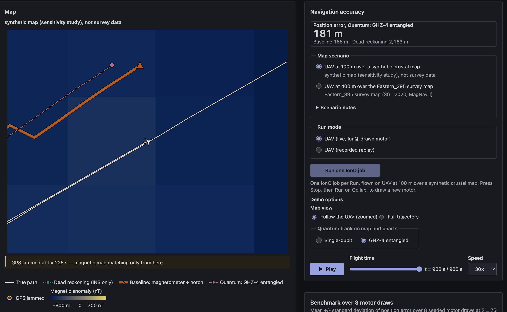

# Quantum MagNav: GPS-denied UAV navigation with an emulated quantum magnetometer

Quantum MagNav keeps a fixed-wing drone located after its GPS is jammed by matching the magnetic field it measures against a survey map of eastern Ontario. The drone's motor drowns that field in tones, so the magnetometer is modelled as a quantum sensor (Ramsey interferometry, run as one circuit on IonQ through Qollab) that sets its own measurement window from the motor RPM and cancels the tones before any data exists. It is compared, with the same number of measurements per sample (an equal shot budget), with an ordinary magnetometer plus a classical notch filter, and the write-up says plainly where the quantum sensor wins, ties and loses. Built for the Qollab x IonQ Hackathon (theme: Quantum Impact).



## Run it on Qollab

1. Open the Quantum MagNav project on [qollab.xyz](https://qollab.xyz) in **Chrome** (Edge or Firefox 153+ also work; Safari does not).
2. On the **Code** tab press **Run Project**, choose the **IonQ Forte 1** remote simulator as the backend, then press **Run**.
3. Wait for Pyodide (Python in the browser) to load. Until then the preview frame reads "refused to connect"; that is expected.
4. The recorded replay loads first. To draw a new motor, keep "UAV (live, IonQ-drawn motor)" selected and press **Run one IonQ job**.
5. Watch the map, then open "This Run's IonQ job" and "Sensor" for the job ID, the quantum random seed, the measured GHZ contrast and the filter function.

Each Qollab Run sends exactly one circuit to IonQ. If the job fails or takes longer than 90 s, the page falls back to the recorded replay with identical visuals. The built-in simulator works too. No IonQ hardware (QPU) is used during the demo.

## Results

All numbers come from `python -m magnav.regen` (files in [`results/`](results/metrics.json)); [docs/BENCHMARK.md](docs/BENCHMARK.md) has every table. The headline scenario is a UAV at 100 m over a **synthetic map (sensitivity study), not survey data**. Each row is the mean ± std over 8 seeded motor draws at S = 256 shots per navigation sample.

| Sensor (S = 256, N = 8) | CEP50 position error | CEP95 | Time under 556 m | Signal error (RMSE) |
|---|---|---|---|---|
| Baseline magnetometer + least-squares notch | 154.8 ± 5.1 m | 266.5 ± 21.0 m | 100 % | 42.7 ± 13.9 nT |
| Ramsey sensor, single qubit | 150.2 ± 0.0 m | 251.4 ± 0.0 m | 100 % | 0.339 ± 0.012 nT |
| Ramsey sensor, GHZ-4 fine stage | 150.2 ± 0.0 m | 251.4 ± 0.0 m | 100 % | 0.195 ± 0.035 nT |
| Dead reckoning (no map matching) | 974.5 m | 2035.9 m | 27.2 % | n/a |

556 m is the RNP 0.3 navigation tolerance. The shots ladder shows where the gain comes from:

| Shots per sample S | Baseline CEP50 | GHZ-4 CEP50 | Baseline signal RMSE | GHZ-4 signal RMSE |
|---|---|---|---|---|
| 64 | 210.9 ± 26.3 m | 150.2 m | 512.5 nT | 0.684 nT |
| 256 | 154.8 ± 5.1 m | 150.2 m | 42.7 nT | 0.195 nT |
| 1024 | 150.2 m | 150.2 m | 0.164 nT | 0.176 nT |
| 4096 | 150.2 m | 150.2 m | 0.085 nT | 0.172 nT |


At low S the baseline reads the field too slowly: many motor harmonics alias next to DC, its notch has to drop them (463 harmonic fits dropped per flight on average at S = 64), and the leftover tones degrade map matching. The Ramsey sensor nulls every harmonic inside its own window regardless of S.

Entangled probes add a second, genuinely quantum effect. A GHZ-n probe reads n times the phase per shot, so entangled probes lower projection noise per shot by up to n at equal shot budget, until gate error and dephasing erode it.


At S = 256 the GHZ-4 projection noise is 0.078 nT at the model contrast and 0.071 nT at the contrast measured on IonQ Forte 1 hardware, against 0.145 nT at the standard quantum limit for 4 unentangled qubits. Physics and the full table: [docs/PHYSICS.md](docs/PHYSICS.md#6-ghz-entangled-probes-the-two-stage-sensor).

### Where it ties or loses

- **High shot budgets tie, and the baseline wins on signal error.** At S = 1024 and 4096 every estimator sits on the same 150.2 m CEP50 floor set by map matching. At S = 4096 the baseline's signal RMSE (0.085 nT) beats GHZ-4 (0.172 nT) and the single qubit (0.104 nT). GHZ-4's signal error levels off near 0.17 nT from 1024 shots on; the amplitude sweep points to residual tone leak, but the mechanism is not isolated. The position advantage exists only at S = 256 or below.
- **GHZ-4 adds nothing at S = 64.** The frozen switch rule keeps the fine stage off at that budget, so GHZ-4 equals the single-qubit stage there.
- **Without the RPM the quantum sensor fails outright.** If the RPM channel is withheld, the tone phase exceeds the sensor's unambiguous ±π/2 range, the probe slips 1800 cycles per flight and CEP50 becomes 7676 m. The baseline falls back to a block mean and barely changes (155.3 m vs 154.8 m). The advantage depends entirely on knowing the interference frequency.
- **Between harmonics the classical filter rejects more.** Both sensors reach the -120 dB floor on every motor harmonic, but the short Ramsey window has higher sidelobes than the baseline's 0.5 s block ([filter-function figure](results/fig_filter_function.png)).
- **How the motor was made loud.** The tone amplitude (A1 = 3600 nT) was calibrated on the baseline alone at S_ref = 256, before any quantum estimator ran. The recorded alternative S_ref = 64 gives A1 = 350 nT, at which the S = 256 comparison would be close to a tie. The [amplitude sweep](results/fig_amp_sweep.png) covers both.
- **The remote simulator shows no entanglement penalty.** The IonQ Forte 1 remote simulator returned GHZ-2 and GHZ-4 contrast 1.000 on every Run. The contrast loss in the figure comes from the model default (0.98^n) and from one hardware job. That QPU job (500 shots requested, 504 counted) measured c2 = 0.996 and c4 = 1.000, so it showed almost no loss either.
- **The navigation gain shrinks at 100 m.** The replay is seeded with the motor drawn on IonQ hardware. On it, the baseline reaches 149.3 m CEP50 at 100 m and 182.2 m at 400 m over the real Eastern_395 map, against 150.2 m and 154.7 m for GHZ-4. As generated by the regen run: "At 100 m on the synthetic map the quantum navigation advantage shrinks compared with the 400 m Eastern_395 flight: GHZ-4 vs LS baseline CEP50 advantage -0.9 m at 100 m vs +27.5 m at 400 m; TERCOM matches lost (LS baseline / GHZ-4) 1/62 vs 0/62 at 100 m and 10/62 vs 0/62 at 400 m. The signal-level advantage (39.1 nT vs 0.2 nT at 100 m) does not depend on the map."

## How it works

A Ramsey magnetometer integrates the field over its interrogation time τ. A motor tone at frequency f contributes exactly zero when fτ is an integer, so the sensor is a low-pass filter with nulls at k/τ (its filter function). A motor at R rpm has harmonics at kR/60 Hz, and choosing τ = 60/R puts every harmonic on a null at once. The slow crustal field (below about 1 Hz) passes. Derivation, servo reference and equal-budget definition: [docs/PHYSICS.md](docs/PHYSICS.md#2-the-window-phase-integral-and-the-filter-function).


Each Run packs everything into one 16-qubit circuit using only `h`, `rz`, `cx` and `measure`, transpiled at optimization level 0: three Ramsey fringe probes, a calibration probe, a GHZ-2 and a GHZ-4 block whose contrast feeds the emulator, and six random-number qubits whose histogram seeds this Run's motor. The header of [results/circuit.txt](results/circuit.txt):

```text
# circuit_sha256 45215a38b2b17c206f657e897ede7e1311332c8996fbbbe232c950ea82212560
# 16 qubits; gates used: h, rz, cx, measure, barrier (rz, h, cx, measure, barrier)
# layout: cal [3], fringe [0, 1, 2], ghz2 [4, 5], ghz4 [6, 7, 8, 9], rng [10, 11, 12, 13, 14, 15]
# transpile optimization_level 0; one backend.run per Run
```

The thousands of navigation windows are emulated in-page with the closed-form phase integral and binomial shot noise; the one IonQ job supplies the random motor and the measured GHZ contrast. The navigation itself is classical map matching (TERCOM) against the anomaly map.

The quantum sensor's filter function is a physical fact about how such sensors work; the field it filters here is injected as gate angles rather than felt; the downstream benefit equals that of a classical notch filter, achieved earlier and without consuming dynamic range.

### What is quantum here

| Component | Quantum? | What it does |
|---|---|---|
| Anomaly map, UAV path, INS drift, GPS jam | No | Classical simulation on survey data (400 m) or a labelled synthetic map (100 m) |
| Motor-tone interference | Parameters only | Deterministic tone model; its parameters come from the random bits below |
| Random bits that pick the motor | On the hardware job only | Six qubits in superposition, measured inside the Run's one IonQ circuit |
| Ramsey sensor readout | Emulated | Phase computed classically and applied as a gate angle; real projection noise and gate error on hardware; never senses a field |
| Tone cancellation by window timing | Sensor physics, emulated | A true property of Ramsey sensing; same benefit as a classical notch applied afterwards |
| GHZ-n fine stage | Emulated, physically meaningful | n entangled qubits read n times the phase; contrast measured on IonQ |
| Baseline notch, TERCOM, metrics, page | No | Classical |

**No quantum advantage is claimed.** The quantum computer picks the problem (random bits) and plays the sensor (emulation). It does not solve the navigation problem better than a classical computer can, and a classical notch applied after the fact reaches the same downstream benefit. What the project shows is how a quantum magnetometer's measurement physics rejects motor noise, end to end, inside a working navigation pipeline.

**Quantum randomness, labelled honestly.** The motor seed is the SHA-256 of the random-qubit histogram. Those bits are physically random only on the hardware job (QPU-measured, IonQ Forte 1 job `01a12aee-d8a8-7e14-b9aa-b11329aca850`, seed `c1dfff10e69fae05`, which seeds the shipped replay). On the Forte 1 remote simulator and the built-in simulator they are pseudo-random, produced by a classical generator, and the page labels them simulator-sampled.

**GHZ, with its qualifier.** The 1/n gain holds only for noiseless probes. Huelga et al. (1997) showed that under uncorrelated dephasing, with the interrogation time optimised, GHZ states give no net gain over unentangled qubits; Monz et al. (2011) measured on trapped ions that correlated noise makes GHZ coherence decay as n². GHZ also shrinks the usable range by n (about ±1.8 nT at n = 4), so it runs only as a fine stage behind the servo and single-qubit coarse stage. Read the GHZ result as what equal-shot projection noise looks like at the measured contrast, not as a claim that a deployed GHZ magnetometer beats an unentangled one.

**Why not Grover.** A Grover search over map positions needs an oracle with coherent access to the whole anomaly map, which means loading the map into a quantum memory that does not exist. Map matching is also already cheap classically, so there is nothing for a quadratic speed-up to save.

**Why not quantum ML.** The first design of this project was a quantum feature-map denoiser. It was dropped because nothing physical motivated it, the expected result was a tie with a classical kernel, and dequantisation work suggests such kernels can often be matched classically. Quantum machine learning has no demonstrated advantage on real sensor data, and claiming one would not survive a technical reading.

## Judging criteria

### Novelty

The quantum subroutine is the sensor itself: interrogation timing cancels interference inside the measurement, and quantum random bits pick a motor the sensor has never seen on every Run. Limits are in [Where it ties or loses](#where-it-ties-or-loses).

### Technical execution

One frozen 16-qubit circuit per Run, a closed-form Ramsey emulator cross-checked against Qiskit's Statevector, an equal-budget baseline frozen before any comparison, one deterministic command that regenerates every number and figure, about 300 automated tests, and a QPU job on IonQ Forte 1. Negative results are in [Where it ties or loses](#where-it-ties-or-loses).

### Impact

Small drones lose GPS to jamming, and their own motors are the main obstacle to magnetic navigation. The demo shows the measurement-side fix and how much of it survives: a clear gain at low shot budgets and at 400 m, a tie at high budgets, and failure without the RPM ([Where it ties or loses](#where-it-ties-or-loses)).

### Documentation

This README, [docs/PHYSICS.md](docs/PHYSICS.md), [docs/BENCHMARK.md](docs/BENCHMARK.md), [docs/QOLLAB_FINDINGS.md](docs/QOLLAB_FINDINGS.md) and [docs/A11Y.md](docs/A11Y.md). Every claim is tied to a regenerated file, and the losing cases are listed in [Where it ties or loses](#where-it-ties-or-loses).

## Run locally

Requires [uv](https://docs.astral.sh/uv/) (it installs the pinned Python 3.13; drop the `~/.local/bin/` prefix if `uv` is on your PATH) and Node.js 24. Tested on macOS; the page itself runs in any browser Qollab supports.

```bash
~/.local/bin/uv sync                          # Python environment from uv.lock
~/.local/bin/uv run pytest -q                 # full test suite (about 4 min)
~/.local/bin/uv run python -m magnav.regen    # rebuild results/, data/benchmark_summary.json and the figures (about 100 s on 8 cores)
npm --prefix web ci && npm --prefix web run dev   # the page at http://localhost:5173 with a local stub for the Python API
bash scripts/package_qollab.sh                # build dist/qollab-upload.zip and check Qollab's limits
```

`python -m magnav.regen --quick` runs a small profile, and `--no-figures` skips matplotlib. Two full runs give byte-identical outputs. `npm --prefix web test` runs the page's unit tests and `npm --prefix web run audit` the accessibility audit.

## Replicate or extend

- **Change the experiment:** the sensor model and equal-budget definition live in `data/qsensor_model.json` and the circuit in `data/circuit_freeze.json`; both are hash-checked, so a change shows up in `results/metrics.json`.
- **New motor or map:** `magnav/motor.py` draws the motor, `magnav/synthmap.py` builds the synthetic map, and `magnav/uav_pipeline.py` runs one flight end to end.
- **Run the circuit elsewhere:** `build_packed_circuit` in `magnav/quantum.py` builds the packed circuit; any Qiskit backend that returns `get_counts()` works.

## Limitations and future work

- **Fixed-wing at 400 m, not a quadcopter.** The real maps are upward-continued to 395 m and lack detail for a quadcopter flying at about 100 m, so the platform is a fixed-wing UAV at about 400 m. The 100 m headline scenario uses a synthetic map (sensitivity study), not survey data.
- **No attitude terms.** The modelled airframe has no magnetised parts, so the interference is motor tones plus white noise. Real aircraft also need attitude compensation (Tolles-Lawson), which spectral filtering cannot provide.
- **Emulated sensor.** The field enters as gate angles; the hardware never feels it.
- **Replay contrast.** The replay uses the model-default GHZ contrast, not the QPU-measured one.
- **Real flight data.** The navigation stage was validated on real Cessna flights with real cabin interference and Tolles-Lawson compensation in the sister project, published as `v0.1.1-smoke` ([GitHub](https://github.com/aaasocial/quantum-magnav), [Qollab](https://qollab.xyz/u/eehhaa/quantum-magnav)). It returns as a recorded tab in v2.

## Accessibility

The page is keyboard-operable, announces changes through an aria-live region, uses a colour-blind-safe palette and honours reduced motion. An axe audit of six page states reports zero violations; see [docs/A11Y.md](docs/A11Y.md).

## Citations, licence and disclosure

Released under the [MIT License](LICENSE). Third-party licences: [THIRD_PARTY_LICENSES.md](THIRD_PARTY_LICENSES.md) and [THIRD_PARTY_WEB_LICENSES.md](THIRD_PARTY_WEB_LICENSES.md).

- **Data:** SGL 2020 MagNav Challenge dataset provided by the United States Air Force pursuant to Cooperative Agreement Number FA8750-19-2-1000 - used 2026-10-09 to 2026-10-11 (Eastern_395 map; real-flight data in v0.1.1-smoke).
- **Map:** Eastern_395 from [MagNav.jl](https://github.com/MIT-AI-Accelerator/MagNav.jl) (`ottawa_area_maps`), MIT License, Copyright (c) MIT Lincoln Laboratory; flown and compiled by Sander Geophysics Ltd.
- **Data terms:** use is limited to non-profit research, non-profit education and government purposes under the Air Force [DATA_SHARING_AGREEMENT.md](https://github.com/MIT-AI-Accelerator/MagNav.jl/blob/master/readmes/DATA_SHARING_AGREEMENT.md) distributed with MagNav.jl. Only small processed crops ship here.
- **Rejected alternative:** EMAG2v3 (doi:10.7289/V5H70CVX) was considered and rejected as too coarse for map matching.
- **GHZ qualifier:** S. F. Huelga et al., Phys. Rev. Lett. 79, 3865 (1997); T. Monz et al., Phys. Rev. Lett. 106, 130506 (2011).

Gnadt et al., arXiv:2007.12158, as requested by the data agreement:

```bibtex
@article{gnadt2023signal,
  title={Signal Enhancement for Magnetic Navigation Challenge Problem},
  author={Gnadt, Albert R. and Belarge, Joseph and Canciani, Aaron and Carl, Glenn and Conger, Lauren and Curro, Joseph and Edelman, Alan and Morales, Peter and Nielsen, Aaron P. and O'Keeffe, Michael F. and Rackauckas, Christopher V. and Taylor, Jonathan and Wollaber, Allan B.},
  archivePrefix={arXiv},
  doi={10.48550/arXiv.2007.12158},
  eprint={2007.12158},
  journal={arXiv},
  pages={1--12},
  url={https://doi.org/10.48550/arXiv.2007.12158},
  year={2023}
}
```

**AI and library disclosure.** Code and documentation were written with the help of Claude Code (Anthropic). Runtime libraries: Qiskit, numpy and scipy in Python (Pyodide in the browser); React, recharts and d3-scale-chromatic for the page. Development only: qiskit-ionq (serialization tests), pytest, matplotlib (figures), Vite, Playwright and axe-core (accessibility audit).

**Questions and issues:** open an issue on the GitHub repository.

This effort is supported by Qollab & IonQ.
