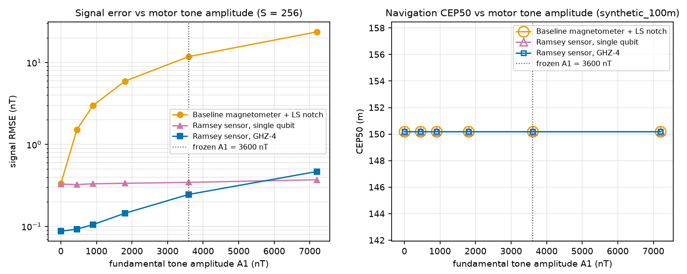

# Benchmark: every table, how it was made, and where the quantum sensor ties or loses

Every number in this file is copied from the regenerated `results/metrics.json` and the CSVs
next to it (`results/benchmark.csv`, `ladder.csv`, `rpm_2x2.csv`, `amp_sweep.csv`,
`ghz_scaling.csv`, `filter_function.csv`). Phase 2 findings are not used here. The sensor
model and the equal-budget definition are in [PHYSICS.md](PHYSICS.md).

## Regenerate

```bash
~/.local/bin/uv run python -m magnav.regen            # full profile: N = 8 draws, S in {64, 256, 1024, 4096}, figures
~/.local/bin/uv run python -m magnav.regen --quick    # quick profile used by the tests: N = 2, S in {64, 256}
~/.local/bin/uv run python -m magnav.regen --no-figures   # numbers only (metrics.json and filter_function.csv are identical either way)
```

On 8 cores the full profile takes about 100 s. Two runs give byte-identical outputs: every
float is rounded to 6 significant figures, keys are sorted, and no output contains a timestamp
or a path. `tests/test_regen.py` runs the quick profile twice and compares sha256 hashes. A
full-profile comparison against the committed files is gated by `MAGNAV_SLOW=1`.

The run writes:

- `results/metrics.json` and the CSVs listed above;
- the four figures `results/fig_ladder.png`, `fig_amp_sweep.png`, `fig_filter_function.png` and
  `fig_ghz_scaling.png`, plus `results/circuit.txt`;
- `data/benchmark_summary.json`, the page's benchmark table;
- `data/precomputed_uav.json`, the replay.

Inputs are pinned by hash in `metrics.json["inputs"]`:

- model `a10a6f62…ac891`
- circuit `45215a38…12560`
- hardware record `08021c8a…78d5`
- both map excerpts

**Draws.** N = 8 seeded local motor draws, from seed rule
`SeedSequence(root, spawn_key=(12, d)).generate_state(1, uint64)[0] >> 1` with d = 0..7. The
benchmark scenario is the UAV at 100 m over the synthetic crustal map (`synthetic_100m`), with
the RPM channel known. Every table reports mean +/- **population** standard deviation
(`ddof = 0`) over the 8 draws. The recorded IonQ seeds are reported as separate labelled rows
and never enter the mean (D-06).

**Estimators.**

- `baseline_ls`: the equal-budget magnetometer with the guarded per-block LS notch (PD-4).
- `baseline_mean`: the same readouts, block mean only.
- `quantum_q1`: the single-qubit Ramsey coarse stage.
- `quantum_ghz4`: the two-stage sensor with the GHZ-4 fine stage.

`quantum_q1` is the single-qubit stage. It is **not** n unentangled qubits. The GHZ track spends
S coarse + S fine shots per sample (disclosed in the frozen model).

**Position metrics.** CEP50 and CEP95 are taken after GPS loss (from t = 285 s), and "% < 556 m"
is the fraction of samples inside RNP 0.3 (0.3 nautical miles). Over the same segment, dead
reckoning (INS only) gives CEP50 974.5 m, CEP95 2035.9 m and 27.2 % under 556 m.

**Nothing from the cut order was cut.** `metrics.json["cut_items"]` is `[]`. The shots ladder
has all four levels, the RPM-withheld case is built, the amplitude sweep runs, and the live
circuit keeps GHZ-4.

## 1. Benchmark by shot budget S (synthetic_100m, N = 8, mean +/- std, ddof = 0)

| S | Estimator | CEP50 (m) | CEP95 (m) | % < 556 m | Signal RMSE (nT) | Mean LS drops per flight |
|---|---|---|---|---|---|---|
| 64 | baseline_ls | 210.9 +/- 26.3 | 526.1 +/- 77.7 | 96.6 +/- 3.6 | 512.5 +/- 117.2 | 463.4 |
| 64 | baseline_mean | 237.4 +/- 36.5 | 590.8 +/- 131.8 | 93.5 +/- 7.2 | 504.9 +/- 114.9 | (n/a) |
| 64 | quantum_q1 | 150.2 +/- 0.0 | 251.4 +/- 0.0 | 100.0 | 0.684 +/- 0.028 | |
| 64 | quantum_ghz4 | 150.2 +/- 0.0 | 251.4 +/- 0.0 | 100.0 | 0.684 +/- 0.028 (GHZ-4 off by the static switch rule, equals q1) | |
| 256 | baseline_ls | 154.8 +/- 5.1 | 266.5 +/- 21.0 | 100.0 | 42.7 +/- 13.9 | 45.0 |
| 256 | baseline_mean | 155.3 +/- 5.1 | 266.1 +/- 20.8 | 100.0 | 46.5 +/- 13.0 | (n/a) |
| 256 | quantum_q1 | 150.2 +/- 0.0 | 251.4 +/- 0.0 | 100.0 | 0.339 +/- 0.012 | |
| 256 | quantum_ghz4 | 150.2 +/- 0.0 | 251.4 +/- 0.0 | 100.0 | 0.195 +/- 0.035 | |
| 1024 | baseline_ls | 150.2 +/- 0.0 | 251.4 +/- 0.0 | 100.0 | 0.164 +/- 0.006 | 0.0 |
| 1024 | baseline_mean | 150.2 +/- 0.0 | 251.4 +/- 0.0 | 100.0 | 10.84 +/- 0.54 | (n/a) |
| 1024 | quantum_q1 | 150.2 +/- 0.0 | 251.4 +/- 0.0 | 100.0 | 0.174 +/- 0.005 | |
| 1024 | quantum_ghz4 | 150.2 +/- 0.0 | 251.4 +/- 0.0 | 100.0 | 0.176 +/- 0.041 | |
| 4096 | baseline_ls | 150.2 +/- 0.0 | 251.4 +/- 0.0 | 100.0 | 0.085 +/- 0.003 | 0.0 |
| 4096 | baseline_mean | 150.2 +/- 0.0 | 251.4 +/- 0.0 | 100.0 | 10.78 +/- 0.55 | (n/a) |
| 4096 | quantum_q1 | 150.2 +/- 0.0 | 251.4 +/- 0.0 | 100.0 | 0.104 +/- 0.006 | |
| 4096 | quantum_ghz4 | 150.2 +/- 0.0 | 251.4 +/- 0.0 | 100.0 | 0.172 +/- 0.042 | |

The quantum sensor recorded no cycle slips in any known-RPM draw (`slips_mean` = 0 at every S).

**Reading it.**

- **S = 64.** The baseline's read rate is 128 Hz, so most motor harmonics alias near DC. The
  guard drops them (463 harmonic fits dropped per flight on average), and the dropped tones
  leave 512 nT of error. The 512 nT RMSE and the drop count belong together. The quantum sensor
  nulls the tones by timing and is limited only by projection noise. Position: 150.2 m vs
  210.9 m CEP50.
- **S = 256** (the live budget, the S_ref of the amplitude rule). The baseline drops 45 fits per
  flight and keeps 42.7 nT of leftover tone. Position: 150.2 m vs 154.8 +/- 5.1 m CEP50. That
  difference is small.
- **S = 1024 and 4096.** The read rate is high enough that no harmonic aliases near DC, the LS
  notch removes every tone, and the baseline's signal RMSE is **lower** than GHZ-4's
  (0.164 vs 0.176 nT at 1024, 0.085 vs 0.172 nT at 4096). At 4096 it is also below the
  single-qubit stage (0.104 nT). Every estimator sits on the same 150.2 m CEP50 floor.

The quantum position advantage therefore appears only at S <= 256. The 150.2 m floor comes from
the map and the INS, not from the sensors.

**GHZ-4 at high S.** If GHZ-4's error came only from projection noise, scaling the measured
S = 256 value by 1/sqrt(S) would give 0.098 nT at 1024 and 0.049 nT at 4096
(`ladder_analytic_rmse_nT`). The measured values flatten at about 0.17 nT instead, so a term
other than projection noise dominates the GHZ-4 track there. In the amplitude sweep (section 3)
GHZ-4's error grows with the tone amplitude while q1's barely moves. That points to residual
tone leakage (in-window RPM ramp) interacting with the fine stage's n-fold smaller range. This
phase did not isolate the mechanism, and it is reported as found.


### Eastern_395 at 400 m (shipped motor, one draw)

These are single runs with the shipped motor on the real survey tile. They are the hollow
markers in `fig_ladder.png`, not means. Each cell gives CEP50 (m) and signal RMSE (nT).

| S | baseline_ls | baseline_mean | quantum_q1 | quantum_ghz4 | LS drops |
|---|---|---|---|---|---|
| 64 | 198.4 / 243.6 | 517.0 / 253.3 | 154.7 / 0.675 | 154.7 / 0.675 | 257 |
| 256 | 162.6 / 11.84 | 169.3 / 17.88 | 157.0 / 0.345 | 154.7 / 0.248 | 26 |
| 1024 | 154.7 / 0.162 | 158.3 / 11.10 | 154.7 / 0.179 | 154.7 / 0.235 | 0 |
| 4096 | 157.0 / 0.084 | 158.3 / 11.03 | 154.7 / 0.116 | 154.7 / 0.233 | 0 |

## 2. RPM known vs RPM withheld (2x2, synthetic_100m, S = 256, N = 8)

With the RPM withheld, the quantum sensor uses tau0 = 10 ms in every window (m = 0) while the
tones stay present, and the baseline LS notch runs with no harmonics (K = 0, the block mean).

| Sensor | RPM known | RPM withheld |
|---|---|---|
| Baseline (`baseline_ls`) | CEP50 154.8 +/- 5.1 m, CEP95 266.5 m, 100 % < 556 m, RMSE 42.7 +/- 13.9 nT (45 LS drops) | CEP50 155.3 +/- 5.1 m, CEP95 266.1 m, 100 % < 556 m, RMSE 46.5 +/- 13.0 nT |
| Quantum (`quantum_ghz4`) | CEP50 150.2 +/- 0.0 m, CEP95 251.4 m, 100 % < 556 m, RMSE 0.195 +/- 0.035 nT, 0 slips | **fails: 1800 slips.** Raw values: CEP50 7676 +/- 1747 m, CEP95 14173 +/- 3575 m, 7.2 +/- 2.8 % < 556 m, RMSE 1.0e7 nT (not meaningful) |
| Quantum single stage (`quantum_q1`) | CEP50 150.2 m, RMSE 0.339 +/- 0.012 nT, 0 slips | **fails: 1800 slips**, same raw values as GHZ-4 (the fine stage never engages) |

The stored note on the withheld cells says that at tau0 the tones exceed the +/-pi/2
unambiguous phase range, and the resulting cycle slips make the signal RMSE meaningless. This
is the clearest negative result: the quantum sensor's advantage depends entirely on the RPM
channel, while without it the classical baseline loses almost nothing. The baseline cells
report LS drops and the quantum cells report slips, so each sensor carries its own provenance.

## 3. Tone-amplitude sweep (synthetic_100m, S = 256, shipped motor, amplitudes scaled to A1)

Signal RMSE (nT). CEP50 is 150.2 m at every point for every estimator except one:
`baseline_mean` at A1 = 7200 nT reaches 148.5 m with 61 of 62 windows accepted. The baseline
drops 26 LS fits at every amplitude, because the drops depend on the RPM, not on A1.

| A1 (nT) | baseline_ls | baseline_mean | quantum_q1 | quantum_ghz4 |
|---|---|---|---|---|
| 0 | 0.334 | 0.334 | 0.328 | 0.0876 |
| 450 | 1.518 | 2.265 | 0.324 | 0.0926 |
| 900 | 2.979 | 4.487 | 0.332 | 0.105 |
| 1800 | 5.928 | 8.950 | 0.336 | 0.145 |
| 3600 (frozen) | 11.84 | 17.88 | 0.345 | 0.246 |
| 7200 | 23.67 | 35.76 | 0.371 | 0.468 |

At A1 = 7200 nT the quantum track records 1 fine-stage slip, 1 fringe-risk sample and 1
fallback to the coarse stage. With no motor (A1 = 0), baseline_ls and quantum_q1 agree
(0.334 vs 0.328 nT), which is the equal-budget parity check. The leftover tone in the baseline
grows linearly with A1. The single-qubit Ramsey stage stays between 0.32 and 0.37 nT.

This sweep uses one motor (the shipped one), so its A1 = 3600 nT point (11.84 nT) differs from
the 8-draw benchmark mean at S = 256 (42.7 nT). That gap is the spread across motor draws: a
motor whose RPM aliases more harmonics near DC at the S = 256 read rate leaves more tone in the
baseline.

**How A1 was chosen (PD-3).** The amplitude was calibrated on the baseline alone, at
S_ref = 256, before any quantum estimator ran. The rule sets A1 to the value at which the
guarded-LS baseline's leftover RMS after the jam equals 0.6 x the median 120-sample window std
of the true anomaly (70.7 nT, so the target is 42.4 nT), taking the median over 5 seeded draws
and rounding to 2 significant figures. The per-draw solutions were 4794, 3437, 3579 and
3623 nT. One draw had no dropped harmonic and so no finite solution, and it was skipped. The
result is A1 = 3600 nT. The recorded alternative, S_ref = 64, gives A1 = 350 nT. Near that
amplitude the table above shows the baseline at a few nT, and the live S = 256 comparison would
be close to a tie.



## 4. GHZ row (synthetic_100m, S = 256, N = 8)

| Estimator | CEP50 (m) | CEP95 (m) | % < 556 m | Signal RMSE (nT) |
|---|---|---|---|---|
| Ramsey sensor, GHZ-4 (`quantum_ghz4`) | 150.2 +/- 0.0 | 251.4 +/- 0.0 | 100.0 | 0.195 +/- 0.035 |
| Ramsey sensor, single qubit (`quantum_q1`) | 150.2 +/- 0.0 | 251.4 +/- 0.0 | 100.0 | 0.339 +/- 0.012 |
| Baseline magnetometer + LS notch (`baseline_ls`) | 154.8 +/- 5.1 | 266.5 +/- 21.0 | 100.0 | 42.7 +/- 13.9 |

`quantum_q1` is the single-qubit coarse stage (one qubit at S shots), not n unentangled qubits.
The GHZ track spends S coarse + S fine shots. For the equal qubit-shot comparison against n
unentangled qubits, see the scaling table below.

**GHZ scaling** (S = 256, tau0 = 10 ms, 4000 trials; nT):

| n | SQL | HL | n unentangled | GHZ-n, model c_n = 0.98^n | GHZ-n, QPU-measured c_n |
|---|---|---|---|---|---|
| 1 | 0.290 | 0.290 | 0.291 | 0.288 | 0.284 |
| 2 | 0.205 | 0.148 | 0.208 | 0.148 | 0.143 |
| 4 | 0.145 | 0.077 | 0.143 | 0.078 | 0.071 |

The model contrasts are c1, c2, c4 = 0.98, 0.9604 and 0.9224. The QPU-measured contrasts, from
job `01a12aee-d8a8-7e14-b9aa-b11329aca850`, are 0.996, 0.996 and 1.000. They exceed the model
default, so the measured series lies on or slightly below the HL line drawn at c1 = 0.98. The
IonQ Forte 1 remote simulator returned contrast 1.000 on every recorded Run (O-1 in
[QOLLAB_FINDINGS.md](QOLLAB_FINDINGS.md)). The Huelga 1997 / Monz 2011 qualifier is in
[PHYSICS.md](PHYSICS.md#6-ghz-entangled-probes-the-two-stage-sensor).


## 5. Recorded IonQ rows (S = 256; never in the mean)

Each row re-flies the benchmark with the motor picked by that job's random-number histogram.
Only the QPU-measured row's bits are physically quantum. On the simulators the bits are
pseudo-random: qiskit-ionq builds noisy-simulator counts from probabilities, and the built-in
simulator samples with a classical PRNG.

| Label | Job | Backend | Seed | Scenario | Baseline LS CEP50 (m) | GHZ-4 CEP50 (m) | Baseline LS RMSE (nT) | GHZ-4 RMSE (nT) | LS drops |
|---|---|---|---|---|---|---|---|---|---|
| QPU-measured | `01a12aee-d8a8-7e14-b9aa-b11329aca850` | ionq_qpu.forte-1 | c1dfff10e69fae05 | synthetic_100m | 149.3 | 150.2 | 39.1 | 0.224 | 22 |
| QPU-measured | `01a12aee-d8a8-7e14-b9aa-b11329aca850` | ionq_qpu.forte-1 | c1dfff10e69fae05 | eastern_400m | 182.2 | 154.7 | 39.1 | 0.228 | 22 |
| simulator-sampled | `01a12b28-f6cc-754a-b9aa-1441fa9b79f8` | ionq_simulator (forte-1 noise) | c77828df74e35765 | synthetic_100m | 146.8 | 150.2 | 44.1 | 0.216 | 19 |
| simulator-sampled | `01a12b2c-7a7d-75af-a1ce-a34acbb6bf1c` | ionq_simulator (forte-1 noise) | 88b8bc7b2962d297 | eastern_400m | 152.7 | 154.7 | 19.6 | 0.209 | 23 |
| simulator-sampled | `600398de-d8b6-4088-856c-389ca867d6c3` | basic_simulator (built-in) | afbbb480ac4d3db7 | synthetic_100m | 153.3 | 150.2 | 35.5 | 0.281 | 28 |

On the synthetic 100 m map, two of the three recorded motors give the baseline a slightly
**lower** CEP50 than GHZ-4 (149.3 and 146.8 m vs 150.2 m), although its signal error is 175 to 205 times larger
(39.1 vs 0.224 nT and 44.1 vs 0.216 nT). At this altitude, position error is not sensitive to the leftover tone.

**The replay** (`data/precomputed_uav.json`) is seeded from the QPU-measured motor
c1dfff10e69fae05, with model-default c_n. Replay CEP50 values:

- synthetic: baseline_ls 149.3 m, GHZ-4 150.2 m;
- Eastern: baseline_ls 182.2 m, baseline_mean 208.5 m, GHZ-4 154.7 m.

These replace the Phase 2 numbers 150.2 / 162.6. The regenerated comparison statement, verbatim
from `metrics.json["replay"]`:

> At 100 m on the synthetic map the quantum navigation advantage shrinks compared with the 400 m Eastern_395 flight: GHZ-4 vs LS baseline CEP50 advantage -0.9 m at 100 m vs +27.5 m at 400 m; TERCOM matches lost (LS baseline / GHZ-4) 1/62 vs 0/62 at 100 m and 10/62 vs 0/62 at 400 m. The signal-level advantage (39.1 nT vs 0.2 nT at 100 m) does not depend on the map.

## 6. Filter function

`results/fig_filter_function.png` is plotted at the shipped motor's median RPM: 6662.29 RPM,
tau = 9.006 ms, f1 = 111.04 Hz, K = 4, m = 1. Both the Ramsey |sinc| and the baseline LS
notch, measured on one 0.5 s block at S = 256 with 0 LS drops, reach the plotted -120 dB floor
at all four harmonics (111.0, 222.1, 333.1, 444.2 Hz). Between harmonics the baseline rejects
more: about -45 dB, against -13 dB for the Ramsey sidelobes. The crustal band is drawn as a
nominal 0-1 Hz band. The derivation is in [PHYSICS.md](PHYSICS.md#2-the-window-phase-integral-and-the-filter-function).


## 7. Where it ties or loses (summary)

- **High shot budget.** At S >= 1024 every estimator is on the same 150.2 m CEP50 floor, and
  the LS baseline's signal RMSE is lower than GHZ-4's (and, at 4096, lower than q1's).
- **The 100 m synthetic map.** At S = 256 the position gain is 4.6 m CEP50 on the 8-draw mean
  (150.2 vs 154.8 m). On the QPU motor's replay the baseline is 0.9 m better.
- **RPM withheld.** The quantum sensor fails outright (1800 slips, CEP50 7676 m), and the
  baseline barely changes.
- **Off-harmonic interference.** The Ramsey window's sidelobes (-13 dB) reject less than the
  baseline's 0.5 s block (-45 dB).
- **Tone amplitude.** A1 = 3600 nT was calibrated on the baseline. At the S_ref = 64
  alternative (350 nT) the live comparison would be close to a tie.
- **The quantum hardware sensed no field.** The phases are gate angles. The benefit equals a
  classical notch applied earlier, without using up dynamic range.

The quantum sensor clearly leads in two places: at low shot budgets (S = 64, where aliasing
cripples the baseline's notch) and on the 400 m Eastern_395 flight (154.7 vs 182.2 m CEP50 on
the QPU motor, with 0 vs 10 TERCOM matches lost).
